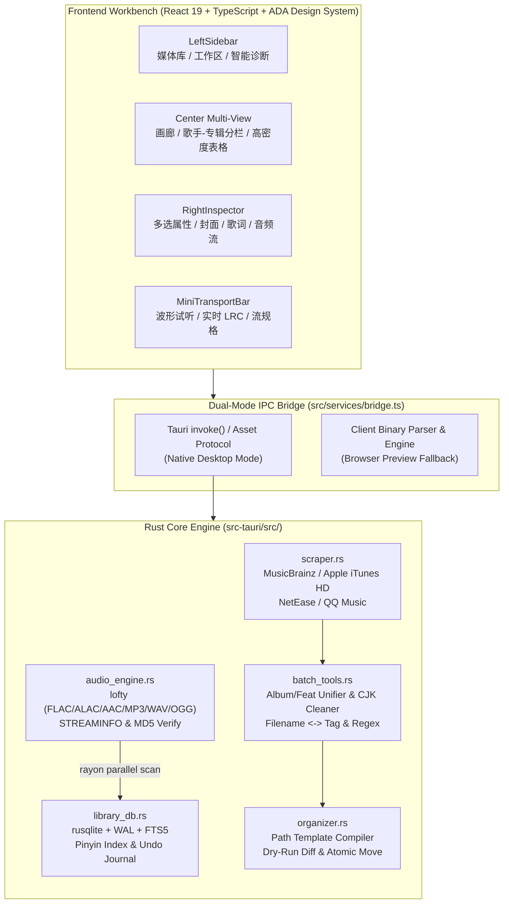
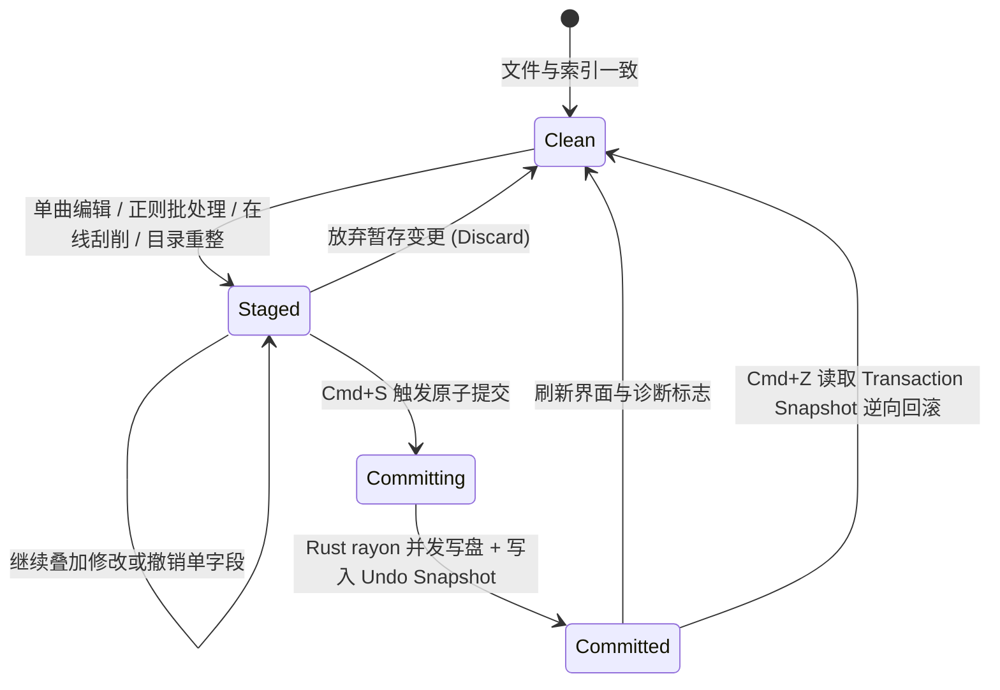

# AWuse — 系统架构与 ADA 精密设计规范

> **定位**：面向无损发烧友与高密度曲库管理者的跨平台桌面端音频元数据工作站（名称源于 `A + Muse`，以倒置的 `W` 象征翻转归位的 Music / Meta 声波）。
> **核心理念**：原生级响应速度、暂存事务队列零误操作、媒体库诊断与物理归档双引擎、克制精密的 ADA 工具美学（零 AI Slop）。

---

## 1. 技术栈与跨平台架构

AWuse 采用 **Tauri v2** 混合架构：底层利用 Rust 的内存安全与多核并发能力处理海量无损文件 I/O，上层通过高精度 WebView 渲染符合 ADA 标准的瑞士精密工程界面。



### 1.1 纯 Rust 零外部依赖音频引擎（无 FFmpeg 依赖）

- **元数据与容器读写 (`lofty 0.21`)**：
  - **FLAC**：完整读写 `VORBIS_COMMENT`（含多值标签与自定义字段如 `ARTISTSORT` / `ALBUMSORT`）、`PICTURE` 封面块（Cover Front/Back）、提取 `STREAMINFO`（采样率、位深、声道数、总采样数、16-byte 音频流 MD5 签名）。利用 FLAC 保留的 `PADDING` 块实现**毫秒级原地标签更新**，避免重写数百 MB 的音频流主体。
  - **Apple Lossless (ALAC) & AAC (`.m4a`)**：原生解析 MP4 `moov/udta/meta/ilst` Atoms（`©nam`, `©ART`, `aART`, `©alb`, `trkn`, `disk`, `©day`, `©lyr`, `covr`, `soar`, `soal`），直接读取 `stsd` 中的 `alac`/`mp4a` 采样率与位深。
  - **兼容格式**：MP3 (ID3v2.3 / ID3v2.4)、WAV (RIFF INFO / ID3)、OGG Vorbis / Opus。
- **内置轻量试听引擎 (`symphonia` + `rodio` / WebAudio)**：仅用于快速核对音轨内容与听音辨识，不做格式转码，保持安装包极度轻量。

---

## 2. 双工作区模式与 SQLite FTS5 数据库 Schema

AWusicMeta 区分两种互补工作流：
1. **持久媒体库模式 (Media Library Mode)**：挂载本地常驻曲库根目录或 SMB 网络共享(Network Root，经 OS 挂载，详见 `docs/adr/0001`)，通过 `rayon` 并行扫描后建立 SQLite WAL + FTS5 索引库，支持千级/万级曲库秒级过滤、拼音 `A-Z` 快速跳转与智能体检诊断。网络根重扫为增量扫描（size+mtime 未变跳过）；挂载点不可达且重挂失败时进入 Offline Root 语义：索引保留、曲目置灰、禁播禁编辑。
2. **临时工作区模式 (Staging Workspace)**：拖拽外部下载目录（如刚解压的专辑包）进入临时沙盒，完成标签清洗、封面配对、散碎专辑归并后，通过目录重整引擎一键归档入库。

### 2.1 SQLite DDL Schema

```sql
PRAGMA journal_mode = WAL;
PRAGMA foreign_keys = ON;

CREATE TABLE IF NOT EXISTS library_roots (
    id          INTEGER PRIMARY KEY AUTOINCREMENT,
    path        TEXT NOT NULL UNIQUE,
    label       TEXT NOT NULL,
    added_at    TEXT NOT NULL,
    last_scan   TEXT,
    source_uri  TEXT,                    -- Network Root 的远端地址(smb://…),本地根为 NULL
    is_network  INTEGER NOT NULL DEFAULT 0
);

CREATE TABLE IF NOT EXISTS covers (
    hash        TEXT PRIMARY KEY,
    mime_type   TEXT NOT NULL,
    width       INTEGER NOT NULL,
    height      INTEGER NOT NULL,
    byte_size   INTEGER NOT NULL,
    cache_path  TEXT NOT NULL
);

CREATE TABLE IF NOT EXISTS tracks (
    id              TEXT PRIMARY KEY,
    root_id         INTEGER REFERENCES library_roots(id) ON DELETE CASCADE,
    workspace_mode  TEXT NOT NULL DEFAULT 'library',
    file_path       TEXT NOT NULL UNIQUE,
    file_name       TEXT NOT NULL,
    extension       TEXT NOT NULL,
    codec           TEXT NOT NULL,
    file_size       INTEGER NOT NULL,
    mtime_ms        INTEGER NOT NULL,

    title           TEXT NOT NULL DEFAULT '',
    artist          TEXT NOT NULL DEFAULT '',
    album_artist    TEXT NOT NULL DEFAULT '',
    album           TEXT NOT NULL DEFAULT '',
    year            TEXT NOT NULL DEFAULT '',
    genre           TEXT NOT NULL DEFAULT '',
    track_number    INTEGER,
    total_tracks    INTEGER,
    disc_number     INTEGER,
    total_discs     INTEGER,
    comment         TEXT NOT NULL DEFAULT '',
    lyrics          TEXT NOT NULL DEFAULT '',
    has_external_lrc INTEGER NOT NULL DEFAULT 0,

    artist_sort     TEXT NOT NULL DEFAULT '',
    album_sort      TEXT NOT NULL DEFAULT '',
    pinyin_initial  TEXT NOT NULL DEFAULT '#',

    sample_rate     INTEGER NOT NULL DEFAULT 44100,
    bit_depth       INTEGER NOT NULL DEFAULT 16,
    channels        INTEGER NOT NULL DEFAULT 2,
    bitrate_kbps    INTEGER NOT NULL DEFAULT 0,
    duration_ms     INTEGER NOT NULL DEFAULT 0,
    stream_md5      TEXT NOT NULL DEFAULT '',
    md5_verified    TEXT NOT NULL DEFAULT 'unknown',

    cover_hash      TEXT REFERENCES covers(hash) ON DELETE SET NULL,
    cover_width     INTEGER DEFAULT 0,
    cover_height    INTEGER DEFAULT 0,
    cover_bytes     INTEGER DEFAULT 0,

    diag_flags      TEXT NOT NULL DEFAULT '[]'
);

CREATE INDEX IF NOT EXISTS idx_tracks_album_group ON tracks(album_artist, album, disc_number, track_number);
CREATE INDEX IF NOT EXISTS idx_tracks_pinyin ON tracks(pinyin_initial, artist_sort);

CREATE VIRTUAL TABLE IF NOT EXISTS tracks_fts USING fts5(
    track_id UNINDEXED,
    title,
    artist,
    album_artist,
    album,
    genre,
    file_path,
    tokenize = 'unicode61'
);

CREATE TABLE IF NOT EXISTS transactions (
    id          TEXT PRIMARY KEY,
    created_at  TEXT NOT NULL,
    summary     TEXT NOT NULL,
    item_count  INTEGER NOT NULL,
    reverted    INTEGER NOT NULL DEFAULT 0
);

CREATE TABLE IF NOT EXISTS transaction_items (
    id              INTEGER PRIMARY KEY AUTOINCREMENT,
    tx_id           TEXT NOT NULL REFERENCES transactions(id) ON DELETE CASCADE,
    track_id        TEXT NOT NULL,
    op_type         TEXT NOT NULL,
    before_json     TEXT NOT NULL,
    after_json      TEXT NOT NULL
);
```

---

## 3. 暂存事务队列与原子落盘状态机

所有高风险的批量修改不直接覆写硬盘文件，而是先进入内存中的 **Staged Changes Queue（暂存队列）**：



---

## 4. 五大核心批处理与整理引擎

1. **物理目录重整引擎 (`organizer.rs`)**：自定义模板 `{AlbumArtist}/{Year} - {Album}/{DiscNumber}-{TrackNumber} {Title}.{ext}`，同步迁移 `.lrc` / `.cue` / `.log` / `cover.jpg`，自动清理空文件夹，Dry-Run 路径 Diff 预览。
2. **散碎专辑自动聚合引擎 (`batch_tools.rs`)**：识别 `feat.` / `ft.` / `/` / `;` / `、` 合唱歌手并推导主导 `Album Artist`，归一化多碟 `DiscNumber` / `TotalDiscs`。
3. **文件名 ⇄ Meta 双向模板解析 & 正则引擎**：支持 `%track% - %artist% - %title%` 反向抽取或生成文件名，及字段正则批处理。
4. **封面与歌词双向批处理**：内嵌封面与外部 `cover.jpg` 互转、封面尺寸统一裁剪优化、内嵌歌词与同名 `.lrc` 双向同步。
5. **CJK 曲库专项清洗 & 拼音 `A-Z` 索引引擎**：GBK / Big5 / Shift-JIS 乱码还原为 UTF-8、繁简中文互转、全半角标点规范化、自动拼音首字母跳转条及按需写入 `ARTISTSORT` / `ALBUMSORT`。
6. **全球 / 华语多源在线刮削 (`scraper.rs`)**：MusicBrainz + Apple iTunes Search HD 封面 + 网易云音乐 + QQ 音乐。

---

## 5. ADA 设计规范与「去 AI Slop」原则

- **零 AI Slop 禁令**：无紫青霓虹发光渐变、无大圆角虚荣统计卡片、无闪烁星星图标、无过度毛玻璃晕染。
- **双色精密系统**：自适应 Dark (`#111113` / `#161619`) 与 Light (`#F5F5F7` / `#FFFFFF`)，`1px` 极细分割线，等宽数字 (`tabular-nums`) 与单宽字体参数展示。
- **克制动效**：统一阻尼曲线 `cubic-bezier(0.22, 1, 0.36, 1)`（140ms），仅过渡 `transform` / `opacity`；列表行选取 `0ms` 即时反馈；全面遵守 `prefers-reduced-motion`。
